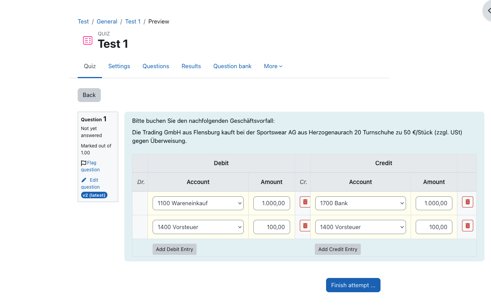
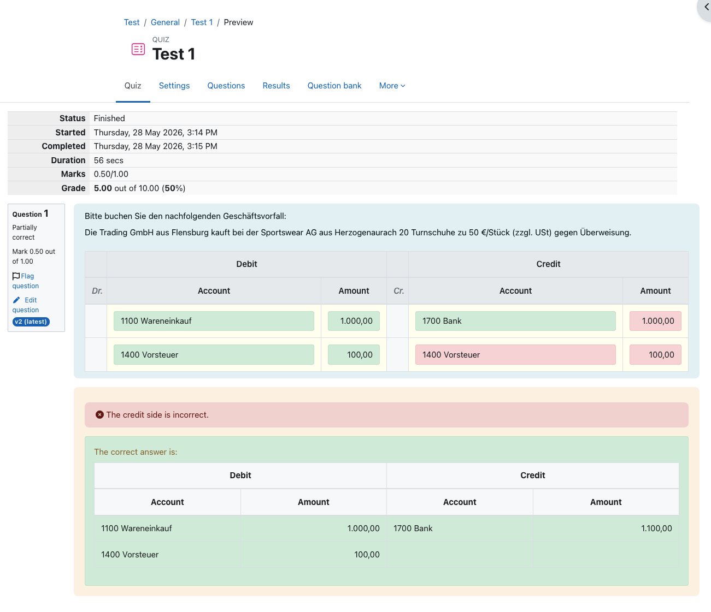

# Accounting Entry (Buchungssatz) question type for Moodle

A Moodle question type for practising double-entry bookkeeping. Students record one or more journal entries (Buchungssätze) by picking debit and credit accounts from a chart of accounts of the question bank and entering amounts. Grading is weighted per field, with an optional all-or-nothing mode and an optional penalty for extra entries.

Developed for **Hochschule Flensburg** by **lambda9**.

> **Plugin name:** `qtype_accounting` &nbsp;•&nbsp; **Current release:** 1.0.0 (stable) &nbsp;•&nbsp; **License:** GNU GPL v3 or later

---

## Contents

- [Screenshots](#screenshots)
- [Features](#features)
- [Requirements](#requirements)
- [Installation](#installation)
- [Quick start](#quick-start)
- [Authoring a question](#authoring-a-question)
- [Accounts and chart of accounts templates](#accounts-and-chart-of-accounts-templates)
- [Grading model](#grading-model)
- [Question import/export](#question-importexport)
- [Backup and restore](#backup-and-restore)
- [Capabilities](#capabilities)
- [Privacy](#privacy)
- [Database tables](#database-tables)
- [Internationalisation](#internationalisation)
- [Bug reports and support](#bug-reports-and-support)
- [Development](#development)
- [Repository layout](#repository-layout)
- [Terminology](#terminology)
- [License](#license)
- [Credits](#credits)

---

## Screenshots

### Authoring a question

Teachers enter the question's accounts or copy them from a template, configure grading behaviour, and add one or more correct-answer entries. Each entry has independent weights for Debit Account, Debit Amount, Credit Account, and Credit Amount, so you can decide how much each field contributes to partial credit.


### Student attempt

Students see one combined table with a Debit side and a Credit side. Account dropdowns are populated from the question's accounts (with an optional set of decoy accounts), and rows can be added or removed on either side.



### Feedback after submission

After submission, every field is highlighted individually — green for correct, red for incorrect. A side-level summary explains what's wrong, and the full correct answer is rendered underneath.



---

## Features

### For students

- Two-sided entry table (Debit / Credit), one journal-entry row at a time.
- Add or remove rows independently on each side.
- Native account dropdowns on desktop and mobile.
- Optional decoy accounts in dropdowns to discourage process-of-elimination guessing.
- Responsive mobile card layout for narrow viewports.
- Moodle App question handler with separate debit/credit entry cards, saved-answer restoration, and read-only review.
- App attempts retain at least one debit entry and one credit entry; Delete buttons appear only when that side has multiple entries.
- Per-field feedback colouring after submission, respecting the quiz's correctness visibility setting, with a side-level summary message.
- Full correct-answer view rendered alongside the student's response.

### For instructors

- Multiple correct-answer entries per question — supports compound bookings (e.g., split-VAT).
- **Per-field weighting** — Debit Account, Debit Amount, Credit Account, Credit Amount each get an independent weight of 1, 2, or 3, used in the partial-credit calculation.
- **No partial credit** option — flips grading to all-or-nothing.
- **Deduction for extra entries** — configurable percentage penalty per extra account the student names that isn't part of the correct answer; each side is counted independently, score is floored at 0.
- **Decoy accounts in dropdowns** — "Number of additional accounts in selection list" controls how many random extra accounts appear alongside the correct ones. `0` shows all accounts of the question.
- **Number format toggle** — `1,234.56` (US) or `1.234,56` (DE).
- **Currency symbol** — €, $, £, CHF or none after the amount fields; the site default is preselected.
- Each question has its own account list, entered one per line in the question form or copied from a chart of accounts template or another question of the same question bank. Later changes elsewhere never change an existing question or its attempts.
- Chart of accounts templates for the whole site, created in Moodle or imported from CSV/text or ODS files, and exported as CSV files (one account per line; UTF-8 or Windows-1252).
- Question import and export through Moodle's standard XML format, with the question's accounts travelling with the question.
- Backup and restore as part of a course's question bank.

---

## Requirements

- **Moodle 4.5.2** or later (build `2024100702`+), which provides the question identity hash API used on restore (MDL-83541). Verified against branches **4.5 LTS through 5.1**.
- **PHP 8.1** or later (8.2 recommended).
- A supported database — verified against **MariaDB 10.11** and **PostgreSQL 16**.

The plugin has no external service dependencies. It does not require Composer, Node, or any third-party hosted service to run.

### Moodle App

The plugin includes a `CoreQuestionDelegate` handler for attempts inside the Moodle
App. Responsive browser layouts alone do not provide app support. If the app says
the quiz only contains unsupported `accounting` questions, update the plugin to a
build containing `db/mobile.php`, `classes/output/mobile.php`, `js/mobileapp/`, and
`templates/mobileapp/`.

After deploying the complete plugin, run the Moodle upgrade through **Site
administration → Notifications**, purge Moodle caches, then log out of the site
in the app and log in again so it downloads the new handler. Mobile web services
and site plugins must be enabled and available to that app/site. No custom app
build is required. Until the updated handler is deployed, students can attempt
the quiz in their phone's browser.

Before using this support for assessed quizzes, verify it against your deployed
Moodle and app versions: enter multiple entries, leave and resume an attempt,
delete a saved entry, submit, and check review/feedback. Test both number formats
and a quiz containing other question types. Offline attempts additionally depend
on Moodle's quiz restrictions and should be tested separately.

When updating an earlier app-support build, refresh the app's downloaded handler
after the upgrade and cache purge: log out of the site in the app and log in again.
The corrected form binds actions to the compiled component, uses Ionic controls
for the app theme, and submits explicit native hidden fields for every answer.

---

## Installation

### From a release ZIP (recommended for production)

1. As a site administrator, go to **Site administration → Plugins → Install plugins**.
2. Upload the release ZIP and follow the prompts. Moodle will validate the plugin and continue to the upgrade screen.
3. Click **Upgrade Moodle database now**.
4. The plugin is now installed; no further configuration is required.

### From source

1. Place the plugin source so that `version.php` sits at `<moodledir>/question/type/accounting/version.php`.
2. As a site administrator, visit **Site administration → Notifications**. Moodle will detect the new plugin and run `install.xml`.

The settings page (**Site administration → Plugins → Question types → Accounting Entry**) sets the default grading mode and the site-wide grading rules for points mode (see [Grading model](#grading-model)), controls whether the leading "Dr." / "Per" label column of the booking table is shown (default: shown), sets the minimum width of the amount inputs (default: 175 px), controls whether the question editor offers "Number of additional accounts in selection list" (default: offered), sets the default currency whose symbol is shown after the amount fields (default: €; each question can choose its own), and manages the chart of accounts templates (see [Accounts and chart of accounts templates](#accounts-and-chart-of-accounts-templates)). All other configuration is per question.

---

## Quick start

1. In any course, create or open a quiz.
2. **Add → A new question → Accounting Entry (Buchungssatz)**.
3. In the question form, enter the accounts students can choose from in **Accounts of this question**, one per line, or copy them from a template with **Copy accounts from**. For example:
   ```
   1200 Bank
   1400 Receivables
   3400 Purchases
   1576 Input VAT
   1600 Payables
   8400 Sales (19% VAT)
   ```
4. Add one or more correct-answer entries; the account dropdowns offer the accounts you entered.
5. Save. The question is now in the course's question bank and can be added to any quiz.

---

## Authoring a question

The question form follows Moodle's standard layout. The accounting-specific section adds:

| Option | Default | Description |
|---|---|---|
| Accounts of this question | *(empty)* | The accounts students pick from, one per line. |
| Copy accounts from | – | Replaces the account list with the accounts of a template or of another question in the same question bank. Shown when such a source exists. |
| Number of additional accounts in selection list | `0` | Decoys per dropdown. `0` = show all accounts of the question; `n` = correct account plus `n` random ones. |
| Number format | `1.234,56` (DE) | Decimal/thousands separators shown to students. |
| Currency | Site default (€) | Currency symbol shown after the amount fields, or no symbol. |
| Deduction for extra entries | None | Percentage subtracted per extra account the student names that isn't in the correct answer. |
| No partial credit | Off | If on, the question grades 0 or full marks only. |

Below those options is the **Correct Answer** table. Each row contributes to grading; you can:

- Add as many rows as you need with **Add Debit Entry** / **Add Credit Entry**.
- Set the four per-field weights for each row (1, 2, or 3) — these become the inputs to the partial-credit calculation described below.
- Delete a row with the trash button on either side.

---

## Accounts and chart of accounts templates

Every question version has its **own account list**. The correct entries and the students' responses refer to the accounts of that list, so changing a template, another question or a later version of the question never changes an existing question version, its correct answer or its saved attempts.

Accounts are identified by a key that stays the same as long as the account name is unchanged, also in new versions of the question. Renaming an account in the list therefore means removing the old account and adding a new one: entries that used it must be updated before saving, and attempts of earlier versions cannot be regraded with a version whose accounts differ.

To share accounts:

- **Within a question bank**, choose another question in **Copy accounts from** and click **Copy**. Its accounts are copied into the question.
- **Across the site**, administrators provide chart of accounts templates on the plugin's settings page (**Site administration → Plugins → Question types → Accounting Entry**). The page lists the templates with edit, download and delete actions; **Create or upload a chart of accounts template** creates a template directly or from a CSV, text or ODS file. Managing templates requires `moodle/site:config`. Templates appear in **Copy accounts from** in every question form.

On a template you can rename it and its accounts in place (click the name), add accounts in a dialogue, delete accounts, import further accounts from a file, or download it as CSV. As questions keep their own copy, changing or deleting a template only affects questions that copy its accounts later. Duplicate account names are rejected, and a failed import leaves existing data intact.

The editor and student interfaces support up to 100 entry rows. Existing imported
solutions above that limit remain supported. Without JavaScript, enter the accounts
and the row count, then use **Update chart and rows** before completing the question.

CSV files may be UTF-8 or Windows-1252 (Excel's default); a UTF-8 BOM, if present, is stripped automatically.

ODS imports read one account name per row from column A of the first sheet. Other columns and sheets are ignored. Put the complete account name (including any account number) in one cell. Blank cells and duplicate names are skipped; an optional account-name header is recognised as with CSV. ODS files can also be imported into an existing template. The upload limit is 2 MB; the uncompressed ODS `content.xml` must not exceed 16 MiB.

Before version 1.1.0, questions referenced shared charts of accounts of their course. The upgrade copies each chart's accounts into the questions that used it, keeping the former account IDs as keys so that correct answers and saved attempts stay valid, and then removes the course charts. Site-wide charts remain as templates.

---

## Grading model

`classes/scorer.php` aggregates entries by `(side, account)` (via `classes/aggregator.php`, which the field feedback uses as well) rather than matching rows positionally. This means the order in which a student types their entries does not matter — only the totals per account on each side. The flow is:

1. **Aggregate the correct answer.** Sum amounts and per-field weights, grouped by `(side, account)`.
2. **Aggregate the student's response** the same way.
3. **Score each correct `(side, account)` pair.**
   - The **account weight** is awarded if the student named that account on that side at all.
   - The **amount weight** is awarded if the student's summed amount for that pair matches the correct sum in integer cents.
4. **Apply penalties.** Subtract the configured percentage per extra account the student named that isn't in the correct answer (each side counted independently). Final score is floored at 0.
5. **All-or-nothing.** If **No partial credit** is enabled, snap the result to 0 or 1.

### Grading modes

Each question uses one of two grading modes. The site default is set in **Site administration → Plugins → Question types → Accounting Entry**; teachers can change it per question.

- **Percentage (weighted)** — the flow above. The result is a fraction of the question's default mark.
- **Points** — every correct `(side, account)` pair (account plus its amount) is worth one point. The question's default mark is set to the number of pairs when the question is saved.
  - With the site setting **Points mode: only fully correct pairs earn points** (default: on), a pair earns its point only if both the account and the amount are correct; weights are ignored and hidden in the editor.
  - With the setting off, the pair's point is split between account and amount according to their weights.
  - The deduction for extra accounts is chosen in points (e.g. 0.5 points per extra account) and subtracted from the earned points; the result cannot go below 0. **No partial credit** applies as in the percentage mode.

### Correct accounts without amounts

The teacher's correct answer always contains accounts and amounts. If the site setting **Points mode: one point for correct accounts without amounts** is enabled, a student who names exactly the correct accounts on both sides (none missing, none extra) but enters no amounts at all receives one point in points mode. Without the setting, such an answer earns nothing when only fully correct pairs count. If the weighted split already yields more than one point, the higher value is kept; **No partial credit** still applies.

Both site settings apply to attempts started after the change; existing attempts keep the rules they started with, also when they are regraded.

Notes:

- Accounts are matched by their key in the question's account list.
- Amounts are parsed and summed as integer cents. Extra decimal places round to the nearest cent, with half cents rounding away from zero. Grading, feedback, hints, and balance validation compare cents exactly.
- Re-grading after edits is supported via Moodle's standard re-grade mechanism. Regrading with another question version requires that version to keep every account of the attempted version.

---

## Question import/export

The plugin extends Moodle's XML format. Exporting a question writes its options, all correct-answer entries (with weights and explanations), and the question's accounts with their keys in a `<chartofaccounts>` block, the format of earlier versions. Importing the question gives it these accounts; exports of earlier versions are imported the same way, so questions move between courses and sites without losing their account list.

Interactive hints also survive XML export and import, including embedded files, text formats, and the clear-wrong and count-correct settings. Hint attachments are available only while that hint is applicable and feedback is visible.

Use **Question bank → Export** / **Import** as you would for any other question type, picking **Moodle XML format**.

---

## Backup and restore

The plugin implements both backup and restore via `backup/moodle2/`. Course backups include questions of this type with their own accounts. Restoring keeps the account keys, so saved attempts need no recoding, and Moodle's question deduplication compares the accounts as part of the question. Backups of earlier versions, which contain the question's chart of accounts, are restored with the chart's accounts as the question's accounts.

---

## Capabilities

The plugin defines no capabilities of its own. Authors of questions use Moodle's question capabilities (`moodle/question:add`, etc.); managing the chart of accounts templates requires `moodle/site:config`, like the plugin's settings page.

---

## Privacy

The plugin stores no personal data beyond the `usermodified` audit column on `qtype_accounting_charts`. The Privacy API provider at `classes/privacy/provider.php` implements:

- `get_metadata()` — declares the single tracked column.
- `get_contexts_for_userid()`, `get_users_in_context()` — list contexts and users with chart-modification history.
- `delete_data_for_all_users_in_context()`, `delete_data_for_user()`, `delete_data_for_users()` — clear the audit column when requested.

Student responses are stored by Moodle's question engine itself, not by this plugin, and are handled by core's privacy provider.

---

## Database tables

All tables are prefixed `qtype_accounting_`:

| Table | Purpose |
|---|---|
| `qtype_accounting_qaccounts` | The accounts of a question version: `questionid`, `accountkey`, `accountname`, `sortorder`. |
| `qtype_accounting_options` | Per-question options: decoy count, number format, grading flags, max entries. |
| `qtype_accounting_entries` | Correct-answer rows: account keys and amounts per side, per-field weights, optional explanation. |
| `qtype_accounting_charts` | Chart of accounts templates: `name`, `contextid` (the system context), timestamps, `usermodified`. |
| `qtype_accounting_accounts` | Accounts of a template: `chartid`, `accountname`, `sortorder`. |

All schema changes go through `db/upgrade.php`.

---

## Internationalisation

The release ships English strings only, per Moodle policy. German is maintained alongside in this repository for the development environment but is excluded from release ZIPs (`lang/de/` is `export-ignore`d in `.gitattributes`).

To contribute a translation, please use the official Moodle translation tool at <https://lang.moodle.org/>.

---

## Bug reports and support

- **Issues:** please file bug reports and feature requests against the project's issue tracker.
- **Contact:** <info@lambda9.de>.

When reporting a bug, please include:

- Your Moodle version (Site administration → Notifications shows it).
- Your PHP version and database engine.
- The version of this plugin (Site administration → Plugins → Plugins overview).
- Steps to reproduce, expected behaviour, and observed behaviour.

---

## Development

Install the plugin into a Moodle development site as described under [From source](#from-source).
GitHub Actions uses the standard Moodle Plugin CI setup with `shivammathur/setup-php` and
`moodle-plugin-ci`, running Moodle checks, PHPUnit and Behat against Moodle 4.5/5.1/5.2/5.3
with both MariaDB and PostgreSQL. The same checks can be run locally with
[moodle-plugin-ci](https://moodlehq.github.io/moodle-plugin-ci/):

```bash
moodle-plugin-ci phplint
moodle-plugin-ci phpcs --max-warnings 0
moodle-plugin-ci phpdoc --max-warnings 0
moodle-plugin-ci validate
moodle-plugin-ci savepoints
moodle-plugin-ci mustache
moodle-plugin-ci grunt --max-lint-warnings 0
moodle-plugin-ci phpunit --fail-on-warning
moodle-plugin-ci behat
```

Within a Moodle checkout, the tests can also be run directly:

```bash
vendor/bin/phpunit --testsuite qtype_accounting_testsuite
php admin/tool/behat/cli/run.php --tags=@qtype_accounting
```

Course exports use Moodle's asynchronous backup queue and therefore need a working
[cron](https://docs.moodle.org/en/Cron).

### Building the AMD modules

```bash
cd question/type/accounting
npx grunt amd
```

Commit `amd/build/` alongside any `amd/src/` change — CI's grunt step compares the two and fails if they drift. For local iteration without rebuilding on every edit, set `$CFG->cachejs = false;` in `config.php`.

### Coding standards

The project follows the [Moodle Coding Style Guide](https://moodledev.io/general/development/policies/codingstyle), enforced by `moodle` + `moodle-extra` phpcs rulesets (`.phpcs.xml.dist`) and a customised PHPMD ruleset (`.phpmd.xml`).

---

## Repository layout

```
moodle-qtype_accounting/                 # Plugin root; unpacks to question/type/accounting/
├── amd/
│   ├── src/                             # ES module sources
│   │   ├── editform.js                  # Authoring form setup and input handlers
│   │   ├── editform/                    # Authoring form modules: state, fields, field_states, accounts, rows, validation
│   │   ├── entry_utils.js               # Shared helpers
│   │   ├── manage_charts.js             # Delete confirmations and the add account dialogue on the template pages
│   │   ├── mobile_layout.js             # Card layout for narrow questions
│   │   └── question.js                  # Student quiz interaction
│   └── build/                           # Minified output (committed)
├── backup/moodle2/                      # Backup + restore handlers
├── classes/                             # Autoloaded under qtype_accounting\
│   ├── admin/setting_sitecharts.php     # Template list on the settings page
│   ├── form/                            # Template create, file upload and add account (modal) forms
│   ├── local/chart_page.php             # Shared setup of the template pages
│   ├── output/                          # Renderables for the templates, Moodle App handler
│   ├── privacy/provider.php             # Privacy API
│   ├── account_manager.php              # Template account CRUD and imports
│   ├── account_provider.php             # Accounts offered in a question's selects
│   ├── aggregator.php                   # Sums entries per side and account
│   ├── amount_helper.php                # Amounts in integer cents
│   ├── chart_manager.php                # Template CRUD, CSV import and export
│   ├── currency_helper.php              # Currency symbols
│   ├── entries_table_builder.php        # Submitted editor entries, editor table
│   ├── entry_helper.php                 # Entry row helpers
│   ├── entry_validator.php              # Server-side validation of the editor
│   ├── feedback_calculator.php          # Field and side feedback
│   ├── import_helper.php                # CSV, text and ODS parsing
│   ├── question_accounts.php            # A question's own accounts and their keys
│   ├── scorer.php                       # Grading (percentage and points)
│   └── xml_handler.php                  # Moodle XML import/export
├── db/
│   ├── install.xml                      # XMLDB schema
│   ├── mobile.php                       # Moodle App handler
│   └── upgrade.php                      # Per-version DB migrations
├── docs/screenshots/                    # README screenshots
├── js/mobileapp/question.js             # Moodle App controller
├── lang/
│   ├── en/qtype_accounting.php          # English (shipped)
│   └── de/qtype_accounting.php          # German (dev-only; export-ignored)
├── pix/icon.svg                         # Question-type icon
├── templates/                           # Mustache templates (question, answer, feedback, editor table, app, template pages)
├── tests/
│   ├── behat/                           # Acceptance tests
│   ├── generator/                       # Test data generator
│   └── *_test.php                       # PHPUnit tests
├── edit_accounting_form.php             # Question authoring form
├── edit_chart.php                       # Edit a template's accounts
├── lib.php                              # In-place renaming of templates and their accounts
├── manage_charts.php                    # Create, upload, export and delete templates
├── question.php                         # qtype_accounting_question
├── questiontype.php                     # qtype_accounting (question_type)
├── renderer.php                         # qtype_accounting_renderer
├── settings.php                         # Site settings
├── styles.css                           # .qtype_accounting-* selectors
├── version.php
├── README.md                            # This file
├── CHANGES.md
└── LICENSE
```

---

## Terminology

| German | English |
|---|---|
| Buchungssatz | Journal entry / accounting entry |
| Soll | Debit |
| Haben | Credit |
| Konto | Account |
| Betrag | Amount |
| Kontenrahmen / Kontenplan | Chart of accounts |
| SKR03 | Standard German chart of accounts (a popular preset, not bundled) |

---

## License

This plugin is licensed under the [GNU General Public License v3 or later](LICENSE).

```
Copyright (C) 2024 Hochschule Flensburg / lambda9.

This program is free software: you can redistribute it and/or modify
it under the terms of the GNU General Public License as published by
the Free Software Foundation, either version 3 of the License, or
(at your option) any later version.
```

---

## Credits

Developed for **Hochschule Flensburg** by **lambda9**.

Contact: <info@lambda9.de>
