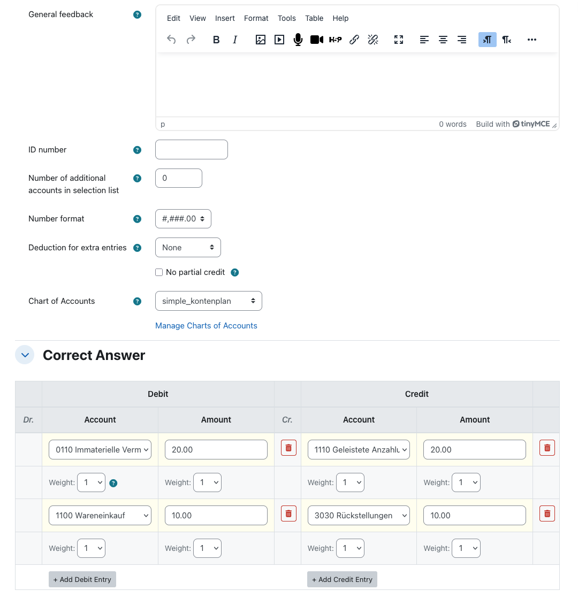

# Accounting Entry (Buchungssatz) question type for Moodle

A Moodle question type for practising double-entry bookkeeping. Students record one or more journal entries (Buchungssätze) by picking debit and credit accounts from a chart of accounts of the question bank and entering amounts. Grading is weighted per field, with an optional all-or-nothing mode and an optional penalty for extra entries.

Developed for **Hochschule Flensburg** by **lambda9**.

> **Plugin name:** `qtype_accounting` &nbsp;•&nbsp; **Current release:** 1.0.0 (stable) &nbsp;•&nbsp; **License:** GNU GPL v3 or later

---

## Contents

- [Screenshots](#screenshots)
- [Features](#features)
- [Requirements](#requirements)
- [Installation](#installation)
- [Quick start](#quick-start)
- [Authoring a question](#authoring-a-question)
- [Managing charts of accounts](#managing-charts-of-accounts)
- [Grading model](#grading-model)
- [Question import/export](#question-importexport)
- [Backup and restore](#backup-and-restore)
- [Capabilities](#capabilities)
- [Privacy](#privacy)
- [Database tables](#database-tables)
- [Internationalisation](#internationalisation)
- [Bug reports and support](#bug-reports-and-support)
- [Development](#development)
- [Repository layout](#repository-layout)
- [Terminology](#terminology)
- [License](#license)
- [Credits](#credits)

---

## Screenshots

### Authoring a question

Teachers pick a chart of accounts, configure grading behaviour, and add one or more correct-answer entries. Each entry has independent weights for Debit Account, Debit Amount, Credit Account, and Credit Amount, so you can decide how much each field contributes to partial credit.



### Student attempt

Students see one combined table with a Debit side and a Credit side. Account dropdowns are populated from the question's chart of accounts (with an optional set of decoy accounts), and rows can be added or removed on either side.


### Feedback after submission

After submission, every field is highlighted individually — green for correct, red for incorrect. A side-level summary explains what's wrong, and the full correct answer is rendered underneath.


---

## Features

### For students

- Two-sided entry table (Debit / Credit), one journal-entry row at a time.
- Add or remove rows independently on each side.
- Native account dropdowns on desktop and mobile.
- Optional decoy accounts in dropdowns to discourage process-of-elimination guessing.
- Responsive mobile card layout for narrow viewports.
- Moodle App question handler with separate debit/credit entry cards, saved-answer restoration, and read-only review.
- App attempts retain at least one debit entry and one credit entry; Delete buttons appear only when that side has multiple entries.
- Per-field feedback colouring after submission, respecting the quiz's correctness visibility setting, with a side-level summary message.
- Full correct-answer view rendered alongside the student's response.

### For instructors

- Multiple correct-answer entries per question — supports compound bookings (e.g., split-VAT).
- **Per-field weighting** — Debit Account, Debit Amount, Credit Account, Credit Amount each get an independent weight of 1, 2, or 3, used in the partial-credit calculation.
- **No partial credit** option — flips grading to all-or-nothing.
- **Deduction for extra entries** — configurable percentage penalty per extra account the student names that isn't part of the correct answer; each side is counted independently, score is floored at 0.
- **Decoy accounts in dropdowns** — "Number of additional accounts in selection list" controls how many random extra accounts appear alongside the correct ones. `0` shows the entire chart.
- **Number format toggle** — `1,234.56` (US) or `1.234,56` (DE).
- **Currency symbol** — €, $, £, CHF or none after the amount fields; the site default is preselected.
- Charts of accounts per question bank, manageable directly from the question form.
- Chart management opens in a large overlay. Choose **Done** to return to the question; chart and account dropdowns refresh automatically while keeping unsaved question entries. Removed selections are flagged for replacement before saving. Unfinished chart edits require confirmation before closing.
- Create charts of accounts directly in Moodle, import CSV/text or ODS files, and export CSV files (one account per line; UTF-8 or Windows-1252).
- Question import and export through Moodle's standard XML format, with the embedded chart of accounts travelling with the question.
- Backup and restore as part of a course's question bank.

---

## Requirements

- **Moodle 4.5 LTS** or later (build `2024100700`+). Verified against branches **4.5 LTS through 5.1**.
- **PHP 8.1** or later (8.2 recommended).
- A supported database — verified against **MariaDB 10.11** and **PostgreSQL 16**.

The plugin has no external service dependencies. It does not require Composer, Node, or any third-party hosted service to run.

### Moodle App

The plugin includes a `CoreQuestionDelegate` handler for attempts inside the Moodle
App. Responsive browser layouts alone do not provide app support. If the app says
the quiz only contains unsupported `accounting` questions, update the plugin to a
build containing `db/mobile.php`, `classes/output/mobile.php`, `js/mobileapp/`, and
`templates/mobileapp/`.

After deploying the complete plugin, run the Moodle upgrade through **Site
administration → Notifications**, purge Moodle caches, then log out of the site
in the app and log in again so it downloads the new handler. Mobile web services
and site plugins must be enabled and available to that app/site. No custom app
build is required. Until the updated handler is deployed, students can attempt
the quiz in their phone's browser.

Before using this support for assessed quizzes, verify it against your deployed
Moodle and app versions: enter multiple entries, leave and resume an attempt,
delete a saved entry, submit, and check review/feedback. Test both number formats
and a quiz containing other question types. Offline attempts additionally depend
on Moodle's quiz restrictions and should be tested separately.

When updating an earlier app-support build, refresh the app's downloaded handler
after the upgrade and cache purge: log out of the site in the app and log in again.
The corrected form binds actions to the compiled component, uses Ionic controls
for the app theme, and submits explicit native hidden fields for every answer.

---

## Installation

### From a release ZIP (recommended for production)

1. As a site administrator, go to **Site administration → Plugins → Install plugins**.
2. Upload the release ZIP and follow the prompts. Moodle will validate the plugin and continue to the upgrade screen.
3. Click **Upgrade Moodle database now**.
4. The plugin is now installed; no further configuration is required.

### From source

1. Place the plugin source so that `version.php` sits at `<moodledir>/question/type/accounting/version.php`.
2. As a site administrator, visit **Site administration → Notifications**. Moodle will detect the new plugin and run `install.xml`.

The settings page (**Site administration → Plugins → Question types → Accounting Entry**) sets the default grading mode and the site-wide grading rules for points mode (see [Grading model](#grading-model)), controls whether the leading "Dr." / "Per" label column of the booking table is shown (default: shown), sets the minimum width of the amount inputs (default: 175 px), controls whether the question editor offers "Number of additional accounts in selection list" (default: offered), sets the default currency whose symbol is shown after the amount fields (default: €; each question can choose its own), and manages the site charts of accounts (see [Site charts of accounts](#site-charts-of-accounts)). All other configuration is per question, and other charts of accounts belong to question banks.

---

## Quick start

1. In any course, create or open a quiz.
2. **Add → A new question → Accounting Entry (Buchungssatz)**.
3. In the question form, click **Manage Charts of Accounts**, enter a chart name, and click **Create chart of accounts**. Add accounts in the editor that opens, or upload a CSV or ODS file instead. Each line of the CSV is one account name, e.g.:
   ```
   1200 Bank
   1400 Receivables
   3400 Purchases
   1576 Input VAT
   1600 Payables
   8400 Sales (19% VAT)
   ```
4. Return to the question form, pick the chart you just created, then add one or more correct-answer entries.
5. Save. The question is now in the course's question bank and can be added to any quiz.

---

## Authoring a question

The question form follows Moodle's standard layout. The accounting-specific section adds:

| Option | Default | Description |
|---|---|---|
| Chart of Accounts | *(none)* | The chart students will pick accounts from. Required. |
| Number of additional accounts in selection list | `0` | Decoys per dropdown. `0` = show all accounts from the chart; `n` = correct account plus `n` random ones. |
| Number format | `1.234,56` (DE) | Decimal/thousands separators shown to students. |
| Currency | Site default (€) | Currency symbol shown after the amount fields, or no symbol. |
| Deduction for extra entries | None | Percentage subtracted per extra account the student names that isn't in the correct answer. |
| No partial credit | Off | If on, the question grades 0 or full marks only. |

Below those options is the **Correct Answer** table. Each row contributes to grading; you can:

- Add as many rows as you need with **Add Debit Entry** / **Add Credit Entry**.
- Set the four per-field weights for each row (1, 2, or 3) — these become the inputs to the partial-credit calculation described below.
- Delete a row with the trash button on either side.

---

## Managing charts of accounts

Charts belong to the **question bank** that holds the question: the course question bank up to Moodle 4.5, the question bank activity (`mod_qbank`) or quiz from Moodle 5.0. Each question bank has its own list, and one bank's charts don't appear in another's question forms.

When a question moves to another question bank, or is saved into a category of another bank, the chart moves with it: an identical chart in the target bank is reused, otherwise the chart is copied. The question's correct answer and saved attempts are switched to the accounts of that chart. Charts in course contexts that can no longer hold questions (Moodle 5.0 and later) move to the course's question bank, also during the plugin upgrade.

You reach the management page from within the question authoring form: when you create or edit an Accounting Entry question, click **Manage Charts of Accounts** in the chart selector. The page requires the `qtype/accounting:managecharts` capability, granted to `manager` and `editingteacher` by default.

On the management page you can:

- **Create a chart directly** by entering its name. The account editor opens so you can add accounts without preparing a file.
- **Upload a CSV, text or ODS file** to create a new chart. The filename becomes the chart name; one account per line.
- **Edit** a chart to rename it and add, edit, delete, or reorder accounts.
- **Download** any chart as CSV.
- **Delete** a chart (with confirmation).

Accounts can be renamed even when used by questions; their IDs and question references
stay the same. Accounts and charts can also be deleted after explicit confirmation.
Deletion warnings explain the impact on existing questions, grading, and saved attempts;
account deletion also lists the questions that use the account or have saved attempts using it.
Duplicate account names are rejected, and a failed import leaves existing data intact.

The editor and student interfaces support up to 100 entry rows. Existing imported
solutions above that limit remain supported. Without JavaScript, choose the chart
and row count, then use **Update chart and rows** before completing the question.

CSV files may be UTF-8 or Windows-1252 (Excel's default); a UTF-8 BOM, if present, is stripped automatically.

ODS imports read one account name per row from column A of the first sheet. Other columns and sheets are ignored. Put the complete account name (including any account number) in one cell. Blank cells and duplicate names are skipped; an optional account-name header is recognised as with CSV. ODS files can also be imported into an existing chart. The upload limit is 2 MB; the uncompressed ODS `content.xml` must not exceed 16 MiB.

### Site charts of accounts

Administrators can provide standard charts for all courses on the plugin's settings page (**Site administration → Plugins → Question types → Accounting Entry**). It lists the site charts with edit, download and delete actions; **Create or upload a site chart of accounts** opens the same create and upload forms as in a course. Managing site charts requires `moodle/site:config`.

Site charts appear in every question form after the question bank's own charts, marked as *(site default)*. In a question bank they are read-only: the management page lists them with **Download** and **Copy to this question bank**, so teachers can adapt a copy. Teachers can still create and upload their own charts.

When questions are restored or imported, a matching chart in the target question bank is reused first, then a matching site chart; otherwise a chart is created in the target question bank.

Charts of deleted courses, question banks and course categories are removed, unless a question still uses them.

---

## Grading model

`classes/scorer.php` aggregates entries by `(side, account)` rather than matching rows positionally. This means the order in which a student types their entries does not matter — only the totals per account on each side. The flow is:

1. **Aggregate the correct answer.** Sum amounts and per-field weights, grouped by `(side, account)`.
2. **Aggregate the student's response** the same way.
3. **Score each correct `(side, account)` pair.**
   - The **account weight** is awarded if the student named that account on that side at all.
   - The **amount weight** is awarded if the student's summed amount for that pair matches the correct sum in integer cents.
4. **Apply penalties.** Subtract the configured percentage per extra account the student named that isn't in the correct answer (each side counted independently). Final score is floored at 0.
5. **All-or-nothing.** If **No partial credit** is enabled, snap the result to 0 or 1.

### Grading modes

Each question uses one of two grading modes. The site default is set in **Site administration → Plugins → Question types → Accounting Entry**; teachers can change it per question.

- **Percentage (weighted)** — the flow above. The result is a fraction of the question's default mark.
- **Points** — every correct `(side, account)` pair (account plus its amount) is worth one point. The question's default mark is set to the number of pairs when the question is saved.
  - With the site setting **Points mode: only fully correct pairs earn points** (default: on), a pair earns its point only if both the account and the amount are correct; weights are ignored and hidden in the editor.
  - With the setting off, the pair's point is split between account and amount according to their weights.
  - The deduction for extra accounts is chosen in points (e.g. 0.5 points per extra account) and subtracted from the earned points; the result cannot go below 0. **No partial credit** applies as in the percentage mode.

### Correct accounts without amounts

The teacher's correct answer always contains accounts and amounts. If the site setting **Points mode: one point for correct accounts without amounts** is enabled, a student who names exactly the correct accounts on both sides (none missing, none extra) but enters no amounts at all receives one point in points mode. Without the setting, such an answer earns nothing when only fully correct pairs count. If the weighted split already yields more than one point, the higher value is kept; **No partial credit** still applies.

Both site settings apply to attempts started after the change; existing attempts keep the rules they started with, also when they are regraded.

Notes:

- Account-name matching is case-insensitive (matching is by account ID after lookup).
- Amounts are parsed and summed as integer cents. Extra decimal places round to the nearest cent, with half cents rounding away from zero. Grading, feedback, hints, and balance validation compare cents exactly.
- Re-grading after edits is supported via Moodle's standard re-grade mechanism.

---

## Question import/export

The plugin extends Moodle's XML format. Exporting a question writes its options, all correct-answer entries (with weights and explanations), and the **full chart of accounts** the question references. Importing the question recreates or reuses an existing chart with matching accounts in the destination context, so questions move between courses and sites without losing their account list.

Interactive hints also survive XML export and import, including embedded files, text formats, and the clear-wrong and count-correct settings. Hint attachments are available only while that hint is applicable and feedback is visible.

Use **Question bank → Export** / **Import** as you would for any other question type, picking **Moodle XML format**.

---

## Backup and restore

The plugin implements both backup and restore via `backup/moodle2/`. Course backups include questions of this type along with their referenced chart of accounts. Restoring a course recreates the chart in the question bank of the restored questions (deduplicating against any matching existing chart).

---

## Capabilities

| Capability | Default roles | Risk | Purpose |
|---|---|---|---|
| `qtype/accounting:managecharts` | `manager`, `editingteacher` | `RISK_CONFIG` | Create, edit, upload, download, and delete charts of accounts of a question bank. |

Authors of questions inherit existing Moodle question capabilities (`moodle/question:add`, etc.) — no extra capability is needed to write Buchungssatz questions beyond standard Moodle quiz/question permissions.

---

## Privacy

The plugin stores no personal data beyond the `usermodified` audit column on `qtype_accounting_charts`. The Privacy API provider at `classes/privacy/provider.php` implements:

- `get_metadata()` — declares the single tracked column.
- `get_contexts_for_userid()`, `get_users_in_context()` — list contexts and users with chart-modification history.
- `delete_data_for_all_users_in_context()`, `delete_data_for_user()`, `delete_data_for_users()` — clear the audit column when requested.

Student responses are stored by Moodle's question engine itself, not by this plugin, and are handled by core's privacy provider.

---

## Database tables

All tables are prefixed `qtype_accounting_`:

| Table | Purpose |
|---|---|
| `qtype_accounting_charts` | Chart definitions: `name`, `contextid`, timestamps, `usermodified`. |
| `qtype_accounting_accounts` | Accounts inside a chart: `chartid`, `accountname`, `sortorder`. |
| `qtype_accounting_options` | Per-question options: chart selection, decoy count, number format, grading flags, max entries. |
| `qtype_accounting_entries` | Correct-answer rows: account IDs and amounts per side, per-field weights, optional explanation. |

All schema changes go through `db/upgrade.php`.

---

## Internationalisation

The release ships English strings only, per Moodle policy. German is maintained alongside in this repository for the development environment but is excluded from release ZIPs (`lang/de/` is `export-ignore`d in `.gitattributes`).

Testserver deployments via `./dev/scripts/deploy.sh` include both English and German strings from the latest commit. Install Moodle's German language pack and select German in Moodle to use the translation.

The local Docker environment mounts the repository's German plugin strings into `moodledata/lang/de_local/qtype_accounting.php`; testserver deployments copy them there. This local customisation takes precedence over translations in the downloaded Moodle language pack, which would otherwise override the plugin's `lang/de/` file. After changing strings, purge Moodle's caches. An existing local container needs to be recreated once to pick up the additional mount.

To contribute a translation, please use the official Moodle translation tool at <https://lang.moodle.org/>.

---

## Bug reports and support

- **Issues:** please file bug reports and feature requests against the project's issue tracker.
- **Contact:** <info@lambda9.de>.

When reporting a bug, please include:

- Your Moodle version (Site administration → Notifications shows it).
- Your PHP version and database engine.
- The version of this plugin (Site administration → Plugins → Plugins overview).
- Steps to reproduce, expected behaviour, and observed behaviour.

---

## Development

The `dev/` directory contains a complete Dockerised dev/CI environment. It is `export-ignore`d in `.gitattributes` and does not ship in the release ZIP.

Development scripts use the Docker containers for PHP, Composer, Node, database
clients, and tests. No host language toolchain is required for builds or CI.
GitHub Actions uses the standard Moodle Plugin CI setup with
`shivammathur/setup-php` and `moodle-plugin-ci`, running Moodle checks, PHPUnit,
and Behat against Moodle 4.5/5.1 with both MariaDB and PostgreSQL.

### Bring up the stack

```bash
# MariaDB-backed (default)
./dev/scripts/start.sh

# PostgreSQL-backed — required for Moodle plugin contribution checklist cross-DB verification
./dev/scripts/start-pgsql.sh
```

Both stacks serve Moodle at <http://localhost:8080>. The Postgres stack overlays `dev/docker-compose.pgsql.yml`.

### Test the installed Android App locally

If Moodle is already running at `http://localhost:8080`, reuse the existing
emulator and open the App without starting or changing the server:

```bash
./dev/scripts/app.sh open
```

This command also restores the emulator's connection to the host's port 8080.
Use `./dev/scripts/app.sh stop` to close the dedicated emulator when finished.

To start the server and provision the sample course as well, choose its database:

```bash
ACCOUNTING_APP_DB=mariadb ./dev/scripts/app.sh start
# For the PostgreSQL environment instead:
ACCOUNTING_APP_DB=pgsql ./dev/scripts/app.sh start
```

This opens a dedicated **Android 13 virtual phone window on this Mac** and installs
and launches the official **Moodle Android App 5.2.1 APK**. It reuses the existing
Android SDK emulator and ARM64 system image, without installing SDK tools or
changing existing virtual devices. Set `ACCOUNTING_ANDROID_SDK` if the existing
SDK is outside `~/Library/Android/sdk`.

In the installed App, enter site **`http://localhost:8080`** and log in with
**`appstudent` / `AppTest123!`**. An ADB reverse connection maps the phone's port
8080 to the host Moodle server. Open **My courses → Accounting App Testing**, then
**Accounting App DE** or **Accounting App US**.

The correct booking is two debit entries (1000 Cash: 500; 1200 Bank: 500) and one
credit entry (8400 Sales: 1000). Use `500,00`/`1000,00` in DE and
`500.00`/`1000.00` in US. These quizzes use **Immediate feedback**: press **Check**
before final submission. Saved but unchecked answers remain "Not complete" in
Moodle and can cause its unanswered warning. For a single final submission,
configure the quiz's question behaviour as **Deferred feedback**.

```bash
./dev/scripts/app.sh open       # Reopen the installed Android App
./dev/scripts/app.sh refresh    # Purge Moodle caches and reset this virtual phone's App data
./dev/scripts/app.sh status
./dev/scripts/app.sh logs
./dev/scripts/app.sh stop       # Stop the dedicated phone; leave Moodle/database running
```

`refresh` signs out this test App and discards unsynced local edits. Server-saved
answers and attempts remain. The dedicated phone's data and APK live under
`dev/mobile/.runtime/android/` (ignored by Git), using ADB serial `emulator-5560`.
Existing virtual devices are left untouched. The helper uses existing host
Python 3 and curl, plus ADB, the emulator, and the system image from the local SDK.
It does not install host tools.

Startup defaults to the existing PostgreSQL Moodle environment; use
`ACCOUNTING_APP_DB=mariadb` to select MariaDB instead. It upgrades the local
plugin, enables mobile web services, and creates or reuses the sample course and
student. It does not reset databases or volumes. Docker is used for the Moodle
server/database only; the App itself runs as an installed APK in Android.

### Background tasks and course exports

Course exports use Moodle's asynchronous backup queue. They require Moodle's
cron runner; the web server alone does not process them. The Docker stack includes
a `cron` service that shares Moodle's image, configuration, plugin mounts and
data volume, runs as `www-data`, and polls for tasks for 60 seconds before Docker
starts the next invocation. This also processes scheduled tasks and restores.

For an existing local stack, explicitly start the new worker:

```bash
docker compose -f dev/docker-compose.yml up -d --no-deps cron
# For an existing PostgreSQL stack, include its override instead:
docker compose -f dev/docker-compose.yml -f dev/docker-compose.pgsql.yml up -d --no-deps cron
```

Inspect worker output with `docker compose -f dev/docker-compose.yml logs --tail=100 cron`.
In Moodle, check **Site administration → Reports → System status** and
**Server → Tasks → Task logs / Ad hoc tasks** to verify cron activity and inspect
any failed backups.

The plugin deployment script only copies the plugin; it does not provision a cron
worker on the deployed server. If that server uses a separate Docker Compose
configuration, configure its host scheduler to run the following every minute
(using the server's actual Compose directory and an absolute Docker executable
path):

```cron
* * * * * cd /absolute/path/to/services/moodle && /usr/bin/docker compose exec -T --user www-data moodle php /var/www/html/admin/cli/cron.php --keep-alive=0 >> /absolute/path/to/moodle-cron.log 2>&1
```

The scheduler account must have access to Docker and permission to write the log.
Alternatively, add a dedicated worker to that server's Compose configuration,
sharing its Moodle image, database settings, `config.php`, plugin and moodledata
mounts, as in the local stack. See [Moodle's cron documentation](https://docs.moodle.org/405/en/Cron).

### Test suites

The pure JavaScript number-format and app-controller regressions use Node from
the running development container:

```bash
./dev/scripts/ci.sh js
```

```bash
./dev/scripts/test.sh              # PHPUnit + Behat
./dev/scripts/test.sh phpunit
./dev/scripts/test.sh behat
```

The app form also has controller tests and Angular DOM tests using Angular
20.3.18, as shipped in Moodle App 5.2.1. Build the optional Docker test image with
locked dependencies, then run without starting Moodle or an app server:

```bash
docker build -t accounting-dom-tests dev/tests/mobileapp
./dev/scripts/js-tests.sh dom       # browser editor/question and Angular app DOM tests
./dev/scripts/js-tests.sh runner    # CI script failure-handling regressions
```

The DOM tests render Angular bindings, dispatch Ionic input events, and serialize
the native quiz form. Ionic tags are custom elements in this harness; it does not
test Ionic overlays or visual appearance, or submit to a live Moodle site.

### Lint and static analysis

```bash
./dev/scripts/ci.sh                # GitHub checks + PHPUnit + Behat
./dev/scripts/ci.sh checks         # static checks + JavaScript regressions
./dev/scripts/ci.sh js             # standalone JavaScript regressions
./dev/scripts/ci.sh scope          # scanner manifests and scope regressions
./dev/scripts/ci.sh codecheck      # phpcs (moodle + moodle-extra)
./dev/scripts/ci.sh codecheck fix  # phpcbf auto-fix
./dev/scripts/ci.sh grunt          # eslint + stylelint + gherkinlint + rollup
```

The container ships `moodle-cs` and `moodle-plugin-ci` ready to run.

The default run uses the same checks and warning thresholds as GitHub Actions:
PHP lint, zero-warning PHPCS and PHPDoc, plugin validation, upgrade savepoints,
Mustache lint, standalone JavaScript regressions, zero-warning Grunt, PHPUnit
with `--fail-on-warning`, and Behat. It reads current working files; no commit is
needed. Checks stop at the first failure. Optional PHPMD and copy/paste checks
remain available through `ci.sh all`.

PHP lint, PHPCS, PHPDoc, validation, savepoints, and Mustache checks use a full
snapshot of tracked and untracked working files, including `dev/`. Deleted and
Gitignored files are omitted. `.moodle-plugin-ci.yml` explicitly excludes `dev/`,
`vendor/`, and `node_modules/` from Moodle Plugin CI's source scanners on both
local and GitHub runs; `.gitattributes` only controls release archives. Local
PHPDoc obtains its file list from the same Moodle Plugin CI selector.

The snapshot sits inside a temporary Moodle directory tree, with core files
linked from the installed version. This preserves moodle-cs's automatic Moodle
version and component detection. A detached plugin copy can silently skip
version-dependent PHPUnit checks when the Moodle version is unknown, while
Moodle 4.5 uses the legacy coverage rules. Local checks verify the detected
root and branch before PHPCS and stop if the context is missing or incorrect.
Test classes place PHPUnit attributes above the class docblock so the legacy
`@covers` tags stay adjacent to the class declaration and both versions work.

Both runners verify and fingerprint the selected file lists before linting.
The guard requires the development helpers to be physically present, checks
that plugin code and PHPUnit tests remain selected, and rejects development
files in the scan. GitHub also compares its installed plugin and checkout file
lists. `ci.sh scope` runs regressions that reproduce the reported development
file failures without the filter and confirm new production errors still fail.
They also reproduce the version-sensitive coverage warning with the real checker
in Moodle 4.5 and 5.1 directory layouts, and reject a detached scan workspace.
Grunt uses a container-native copy of the same snapshot, arranged as
`question/type/accounting` with the installed Moodle build tools. Its backup and
restore never traverse host bind mounts, avoiding Docker Desktop's stale file
size errors. Runtime tests use the mounted Moodle installation.

Run against an already provisioned development stack. These scripts do not
install missing tools or start services. The local run covers the current
Moodle/PHP/database environment with the configured Firefox browser; GitHub
Actions covers Moodle 4.5/5.1 with MariaDB/PostgreSQL using PHP 8.3 and Chrome.
The browser runner copies current upload fixtures into Selenium so file uploads
can resolve the same paths as Moodle without recreating containers.

### Building the AMD modules

```bash
./dev/scripts/build.sh             # compile amd/src → amd/build with Moodle's grunt/rollup pipeline
```

Commit `amd/build/` alongside any `amd/src/` change — CI's grunt step compares the two and fails if they drift. For local iteration without rebuilding on every edit, set `$CFG->cachejs = false;` in `dev/docker/config.php`.

### Coding standards

The project follows the [Moodle Coding Style Guide](https://moodledev.io/general/development/policies/codingstyle), enforced by `moodle` + `moodle-extra` phpcs rulesets (`.phpcs.xml.dist`) and a customised PHPMD ruleset (`.phpmd.xml`).

For deeper architectural notes, see [`dev/CLAUDE.md`](dev/CLAUDE.md).

---

## Repository layout

```
moodle-qtype_accounting/                 # Plugin root; unpacks to question/type/accounting/
├── amd/
│   ├── src/                             # ES module sources
│   │   ├── editform.js                  # Authoring form behaviour
│   │   ├── entry_utils.js               # Shared helpers
│   │   ├── mobile_layout.js             # Card layout for narrow viewports
│   │   └── question.js                  # Student quiz interaction
│   └── build/                           # Minified output (committed)
├── backup/moodle2/                      # Backup + restore handlers
├── classes/                             # PSR-4 autoloaded under qtype_accounting\
├── db/
│   ├── access.php                       # Capability definitions
│   ├── install.xml                      # XMLDB schema
│   └── upgrade.php                      # Per-version DB migrations
├── docs/screenshots/                    # README screenshots
├── lang/
│   ├── en/qtype_accounting.php          # English (shipped)
│   └── de/qtype_accounting.php          # German (dev-only; export-ignored)
├── pix/icon.svg                         # Question-type icon
├── tests/
│   ├── behat/                           # Acceptance tests
│   ├── generator/                       # Test data generator
│   ├── question_test.php                # PHPUnit: grading
│   └── questiontype_test.php            # PHPUnit: save/load + XML
├── edit_accounting_form.php             # Question authoring form
├── edit_chart.php                       # Edit a single chart's accounts
├── manage_charts.php                    # Chart list of a question bank, or the site charts
├── question.php                         # qtype_accounting_question
├── questiontype.php                     # qtype_accounting (question_type)
├── renderer.php                         # qtype_accounting_renderer
├── styles.css                           # .qtype_accounting-* selectors
├── version.php
├── README.md                            # This file
├── CHANGES.md
├── LICENSE
└── dev/                                 # Dev tooling — not shipped in release ZIP
```

---

## Terminology

| German | English |
|---|---|
| Buchungssatz | Journal entry / accounting entry |
| Soll | Debit |
| Haben | Credit |
| Konto | Account |
| Betrag | Amount |
| Kontenrahmen / Kontenplan | Chart of accounts |
| SKR03 | Standard German chart of accounts (a popular preset, not bundled) |

---

## License

This plugin is licensed under the [GNU General Public License v3 or later](LICENSE).

```
Copyright (C) 2024 Hochschule Flensburg / lambda9.

This program is free software: you can redistribute it and/or modify
it under the terms of the GNU General Public License as published by
the Free Software Foundation, either version 3 of the License, or
(at your option) any later version.
```

---

## Credits

Developed for **Hochschule Flensburg** by **lambda9**.

Contact: <info@lambda9.de>
